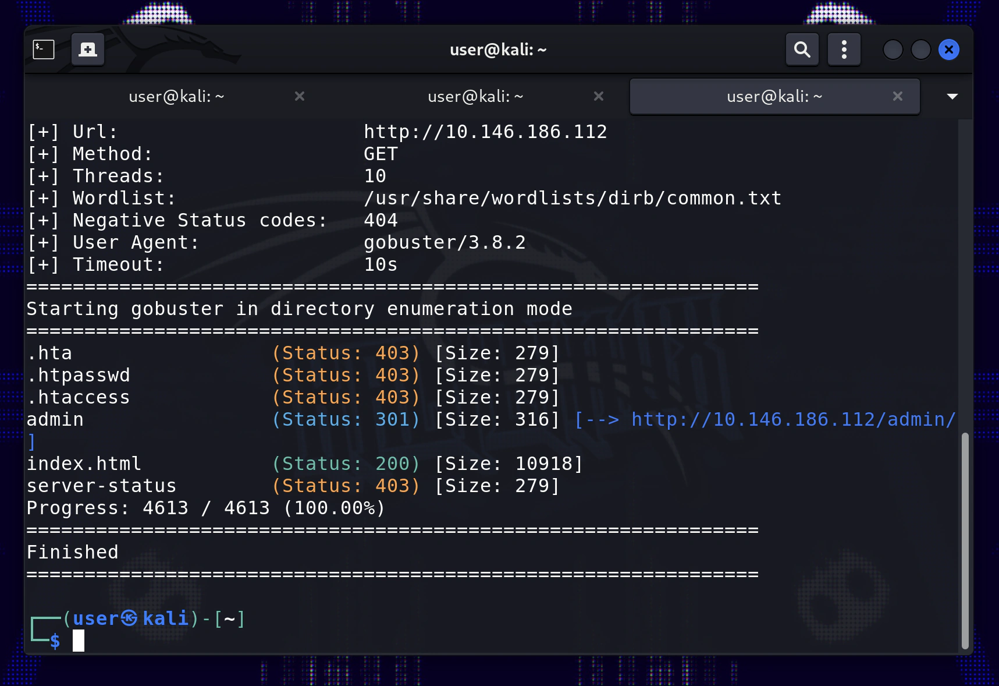

## Introduction

The Brute It CTF found on TryHackMe [here](https://tryhackme.com/room/bruteit), I found to be a great beginner CTF challenge room. It is great because it covers a classic pentesting pattern: reconnaissance, initial access/getting a shell, and then privilege escalation/getting root access on the target machine. These are core steps in any cybersecurity penetration testing framework, and it was fun to go through the stages in a straightforward way.

In this writeup

## Reconnaissance

### How many ports are open?

### What version of SSH is running?

:::spoiler Reveal spoiler
`OpenSSH 7.6p1`
:::

### What version of Apache is running?

:::spoiler Reveal spoiler
`2.4.29`
:::

### Which Linux distribution is running?

:::spoiler Reveal spoiler
`Ubuntu`
:::

### What is the hidden directory?

:::spoiler Reveal spoiler
`/admin`
:::

## Getting a shell

### What is the user:password of the admin panel?

:::spoiler Reveal spoiler
`admin:xavier`
:::

### What is John's RSA Private Key passphrase?

:::spoiler Reveal spoiler
`rockinroll`
:::

### user.txt

:::spoiler Reveal spoiler
`THM{a_password_is_not_a_barrier}`
:::

### Web flag

:::spoiler Reveal spoiler
`THM{brut3_f0rce_is_e4sy}`
:::

## Privilege escalation

### What is the root's password?

:::spoiler Reveal spoiler
`football`
:::

### root.txt

:::spoiler Reveal spoiler
`THM{pr1v1l3g3_3sc4l4t10n}`
:::

