## Introduction

I found the [Brute It](https://tryhackme.com/room/bruteit) CTF on TryHackMe to be a great beginner CTF. It covers a basic and classic pentesting pattern: reconnaissance, initial access/getting a shell, and then privilege escalation/getting root access on the target machine. These are core steps in any cybersecurity penetration testing framework, and it was fun to go through the stages in a straightforward way.

To complete this CTF I connected my Kali Linux VM to the TryHackMe network via VPN, and started the target machine. When the target machine instance became available, an IP address for the target machine appeared. The target machine I received was `10.146.186.112`, this will be the IP address all scans and tests will be directed towards.

```terminal title=target_ip.txt
10.146.186.112
```

First thing to do is to make sure the VPN connection is working, and that I can actually connect to the target machine, therefore we'll do a quick ping scan as shown here.

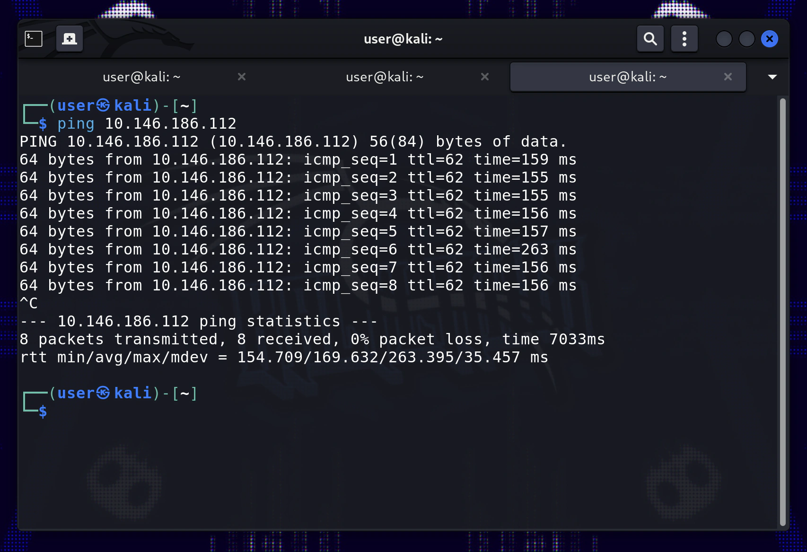

Inspecting the ping output, we can see my machine is successfully reaching the target machine. Now I'll be going through the questions for this CTF from start to finish.

## Reconnaissance

To begin we can start with some reconnaissance, the process of scouting and mapping out the network attack surface - looking for any open ports and services, or anything else.

### How many ports are open?

The first question asks how many ports are open. To test this we'll use Nmap, an industry standard network mapping and scanning tool.

Scanning for open ports is simple, we'll use the following command to do a stealth/half-open scan using `-sS`, this will make less noise than a regular TCP connect scan (using `-sT`). We will include the version information flag `-sV`, which will give extra information for the services of any open ports that are found, this will also be necessary to answer the next few questions. The whole command is:

```
sudo nmap -sS -sV 10.146.186.112
```

Using the command above to scan the target we get the following output as shown in the image below.

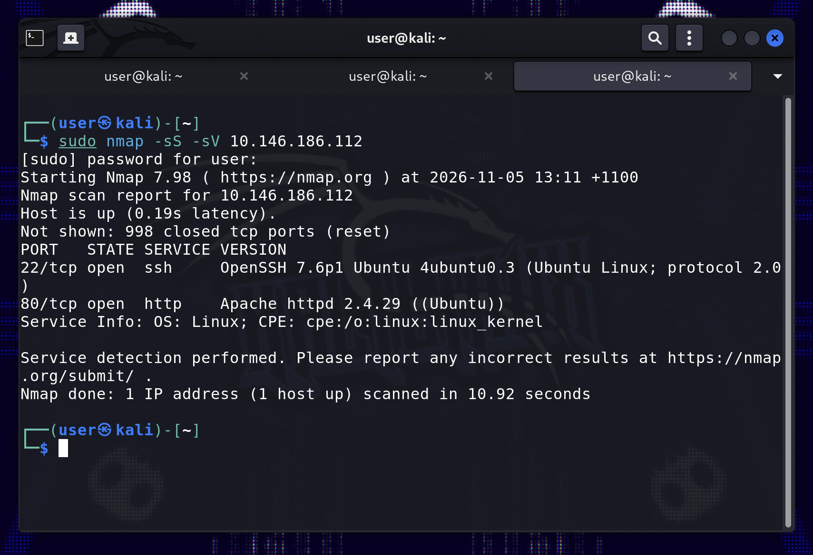

We can clearly see there are ||2|| ports open, tcp port 22 and tcp port 80.


### What version of SSH is running?

Since we already ran the scan with version detection we can look for the open port 22 line, where we can notice the service is ssh (as expected), and that the version of ssh is: 

:::spoiler 
OpenSSH 7.6p1
:::

### What version of Apache is running?

Again, within the same scan report we can answer this question too. Apache is web server software, so it'll make sense for it to be found on the version details for the port 80 http service line, and here we can see the Apache version is: 

:::spoiler
2.4.29
:::

### Which Linux distribution is running?

Now we need to look for any information about the Linux distribution. Thankfully this is also found alongside the version information from the scan. Looking back at the report, on the version information section for either of the open ports, we can see some references for ||Ubuntu|| being the Linux distribution.


### What is the hidden directory?

At this point we have found a few useful pieces of information in the reconnaissance so far. We have two open ports to target. We also know that one of them is a web server, because it is port 80 running an http service with a particular Apache version.

We could take a few different approaches at this point, but the next question is quite clear in the intended direction. We need to find the hidden directory. This would likely be referencing a web directory as we have access to the public facing web server already at: http://10.146.186.112

If we visit the index page of the web server we just see a default landing page for an Apache web server.

A tool that is perfect for this is Gobuster, using it we can do a directory scan with `dir`, provide a target URL with `-u`, and provide a directory wordlist to automatically scan from using the `-w` flag. The command I used was the following:

```
gobuster dir -u http://10.146.186.112 -w /usr/share/wordlists/dirb/common.txt
```

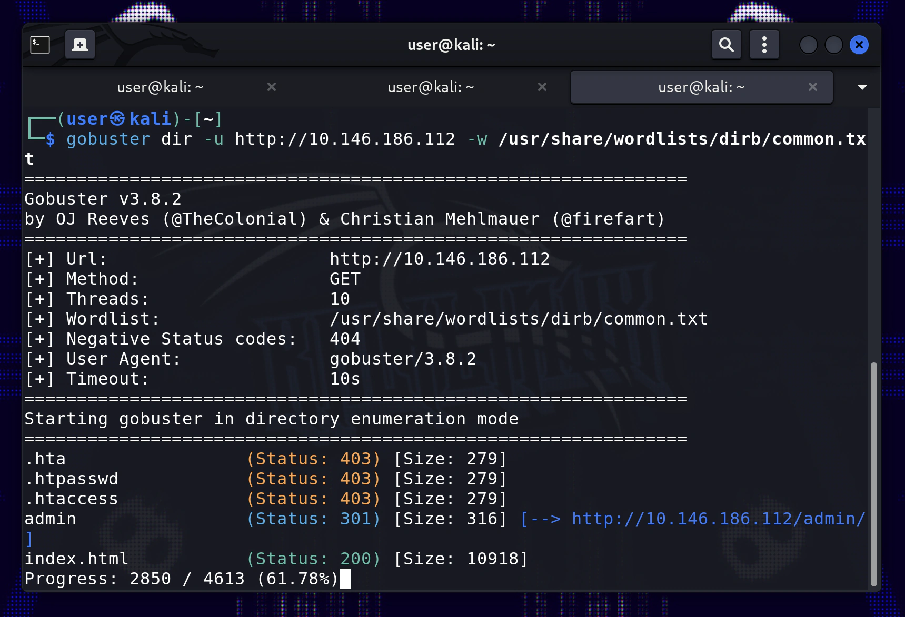

Looking at the image above, we can see results from the gobuster scan, and in these results we can identify a very pertinent looking hidden directory: ||/admin||.

Now we have completed the reconnaissance part. We now have a couple of open ports with services to target, an http web server, and an ssh service. We have also now discovered a hidden directory which we can target in the next phase 'Getting a shell'.


## Getting a shell

In this phase of the CTF, we'll move on from reconnaissance, and now attempt to get a shell on the target machine.

### What is the user:password of the admin panel?

Naturally, after discovering the newly found directory `/admin`, we will want to visit it at http://10.146.186.112/admin as shown in the image below.

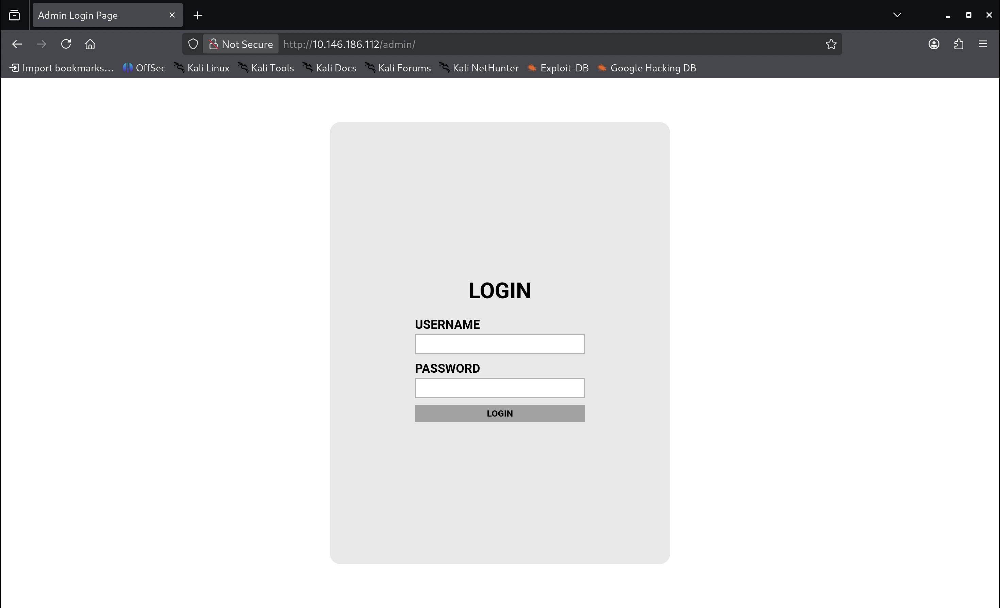

Here we can see an admin login panel. Going along with the question, we want to find out the user:password of the admin panel.

The first thing I did was view the page source by right-clicking and selecting view source.

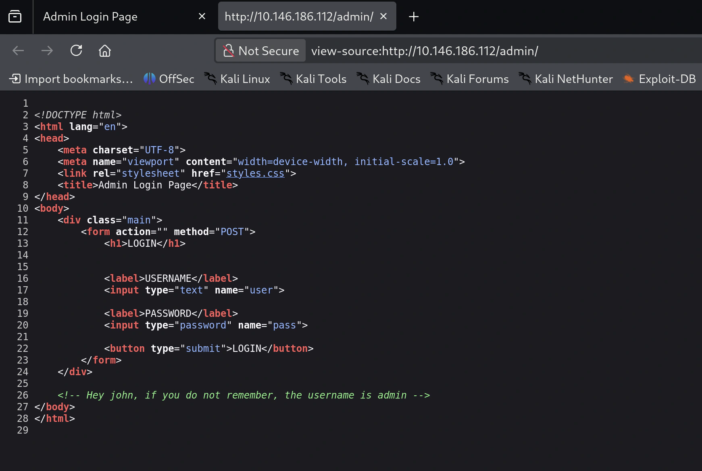

In this image we can see the html source code of the admin panel. There is some useful information here.

The first thing that stands out is the comment at the bottom. This comment gives away two important bits of information.

1. There is a person/administrator named John
2. The username is admin

So from this we have half of the login info, the username is `admin`. Having this will actually allow us to attempt to brute-force/dictionary attack the password using a tool like Hydra.

Before doing that we can also note in the source code the name values `user` and `pass` of the input tags in the form. These values will be needed for our Hydra command to brute-force the password.

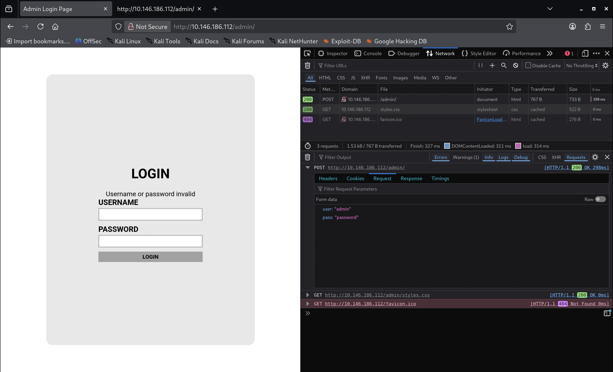

Another way of confirming these form input name values is shown in this image here. Here I've opened the browser developer tools and navigated to the network tab. Next I attempted to log in with any username and password to test the request to and response from the server/target machine. This first image shows the information from the resulting http POST request (as found in the request tab of this particular POST request).

The form data shows:

```terminal title=form_data.txt
user: 'admin'
pass: 'password'
```

So we can see again that the form input values are `user` and `pass`, and that the test I did took my input of `admin` and `password` respectively.

Hydra needs these values in order to know how to make legitimate requests to the server when brute-forcing the admin panel.


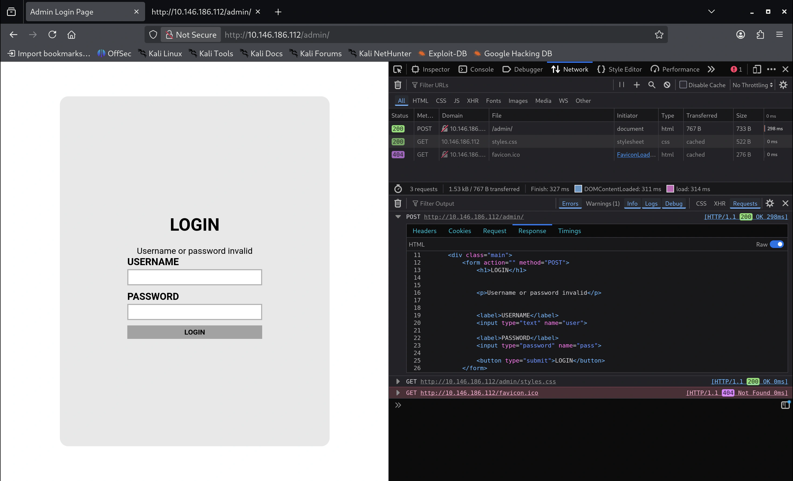

This image shows the response tab from the same test request I made. Here I've toggled the raw html code, and we can see the actual html response body that was received back to the client/browser.

Here there is another important piece of information we'll need for the Hydra command: `Username or password invalid`. This is some text that is found in the html response body when there has been a failed login, Hydra needs an identifier like this to determine the failure or success of each login attempt.

Now we have everything we need to attempt a dictionary attack on the login with Hydra.

:::note
This is a dictionary attack because it will be using a word list to draw the passwords from (if the password is not on the list it won't succeed), whereas a brute-force attack would incrementally go through many character variations in the specified pattern without a word list (this is much slower, but with enough time it could find passwords that aren't on a list). 
:::

The full command is shown here:

```
hydra -l admin -P /usr/share/wordlists/rockyou.txt 10.146.186.112 http-post-form "/admin/:user=^USER^&pass=^PASS^:F=Username or password invalid" -t 32 -f -V
```

Let's break down the command: 
- `hydra` is the name of the tool/program
- `-l` specifies the login/username, we're using `admin` here
- `-P` specifies a password list file, we are using the infamous `rockyou.txt` leaked password file
- `http-post-form` specifies the service type to be targeted, for this service type there are 3 parts separated by a colon:
    - `/admin/` is the URL path being targeted
    - `user=^USER^&pass=^PASS^` uses the `user` and `pass` form input name values being targeted (as mentioned earlier), `^USER^` and `^PASS^` are used as a placeholder/marker for the substituted values to be attempted by Hydra
    - `F=Username or password invalid"` indicates text found in the failure response
- `-t` specifies the number of threads to be used (more is faster but noisier)
- `-f` tells Hydra to stop as soon as a valid login is found
- `-V` specifies verbose mode, giving more information as the command runs


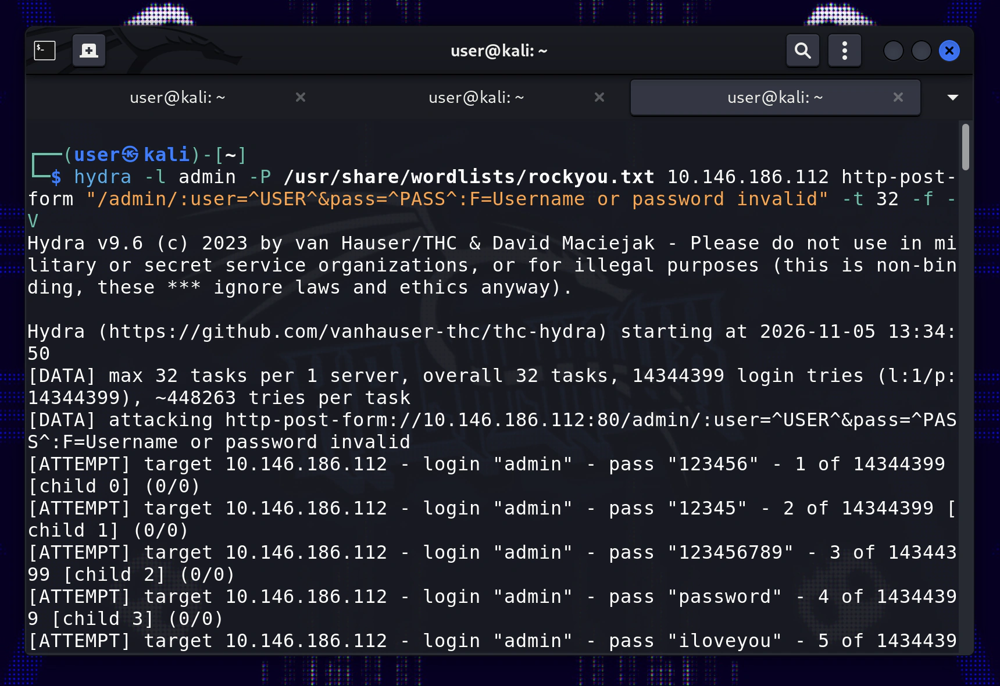

Here we can see the command as it begins to run.


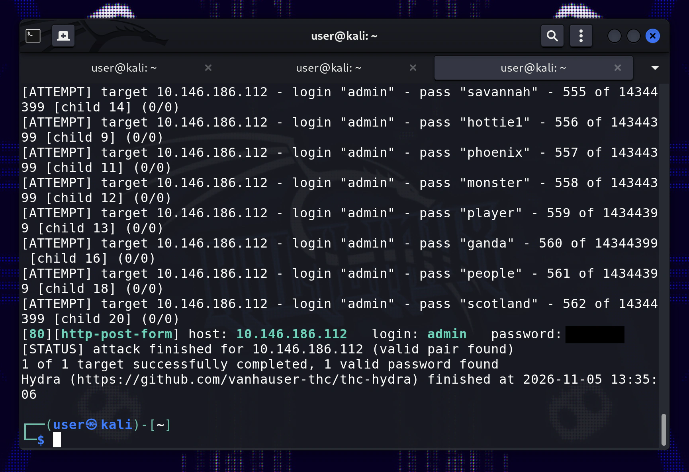

And here we can see the end of the output after 563 attempts, Hydra successfully did a dictionary attack on the login and found the correct password for the admin username, as shown in the screenshot above.

Nice! We should now have access to the admin panel at http://10.146.186.112/admin. If we now enter in the username and password we just discovered we will successfully login and be greeted with the webpage as shown in the image below.

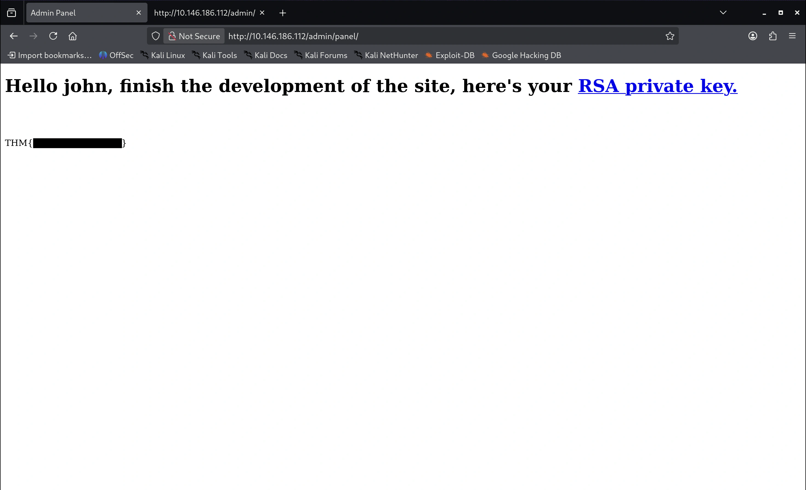

On this page we can see a few things:

- Some greeting text telling John to finish building the website
- A link to an RSA private key
- A THM flag (this is an answer to one of the questions a bit further down)

Saving the flag for later, let's click through and view the RSA key link.


### What is John's RSA Private Key passphrase?

The next question is asking what John's private key passphrase is, well, after clicking through we can see an RSA private key which is a big find, but we do not yet have the passphrase for this private key. Below we can see a screenshot of the RSA private key.

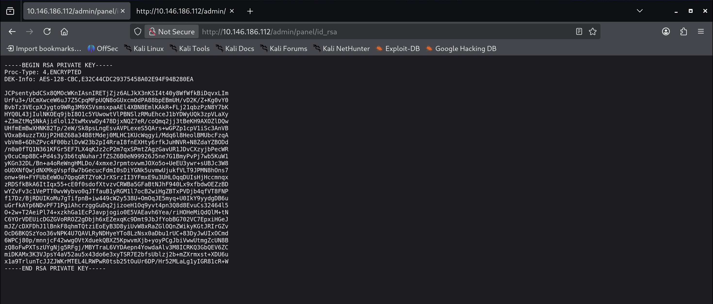

Let's see what we can do with this private key. An RSA private key is a cryptographic key often used for making ssh logins more secure than using just a password, and we know that we have already found an open port that uses the ssh service at tcp port 22. Let's see what happens when we try to log in to ssh on the target machine using this private key that we have acquired.

To do this we'll quickly make a private key file using the key we found, I simply created a file called `id_rsa` using nano (the CLI text editor), pasted in the key, saved the file and checked the output using `cat id_rsa`. These steps can be seen in the screenshot below.

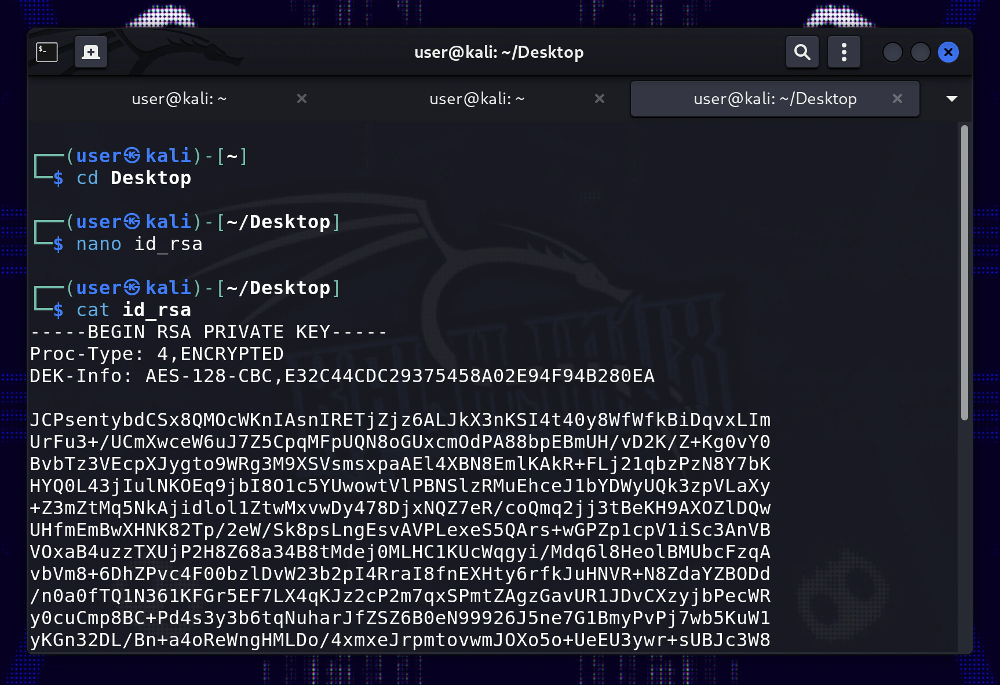

Now that we have the private key in a file, we can try to log in to John's account on the target machine using his ssh login information. We can do this with the following ssh command:

```
ssh -i id_rsa john@10.146.186.112
```

- `-i` specifies the identity/private key file we want to use, for this we will use the `id_rsa` key file we just created
- `john@10.146.186.112` is the login information for ssh
    - `john` is the username I am guessing is used for John's account
    - `@10.146.186.112` specifies which machine we want to log in `@`, in this case it is going to be the target machine `10.146.186.112`

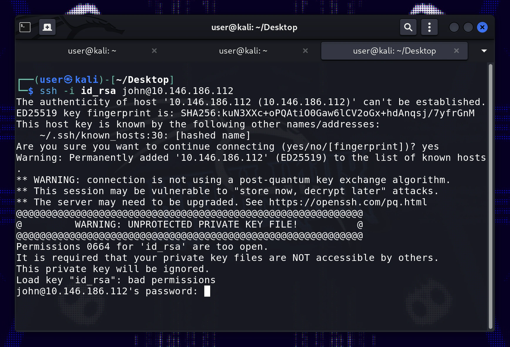

After attempting to log in using the command and following the prompts, we see the output as seen in the image above. It is saying that the permissions of the private key file are too open, and as a protective measure it won't let us use the key file. To fix this we can change the file permissions of the key file to be more restrictive.
I did this with the following commands:

```
ls -l
chmod -600 id_rsa
stat id_rsa
```

Below is the output of these commands.

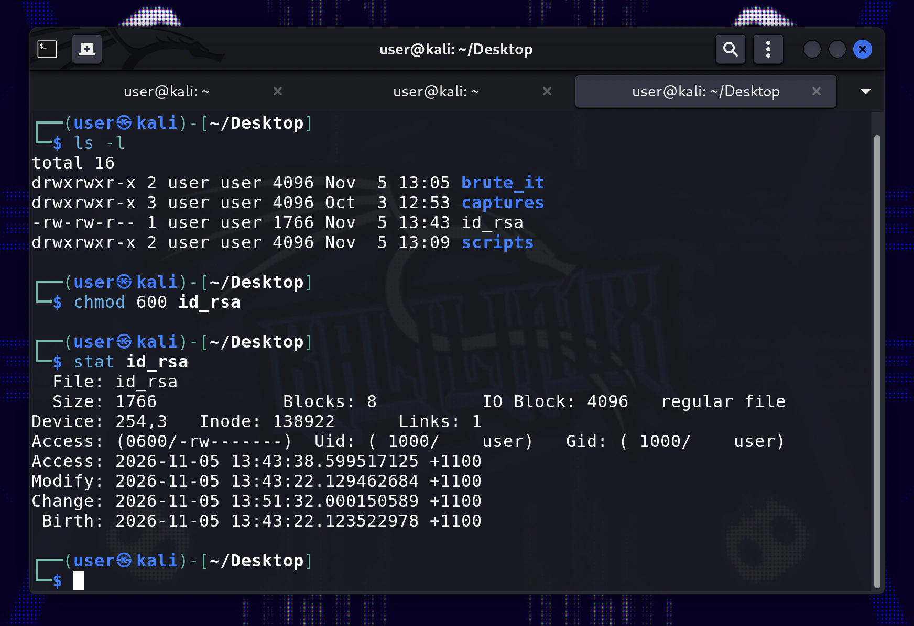

Breaking these commands down:
- With `ls -l` I listed the files in my current directory (the directory containing the key file). The `-l` flag displays the list in the 'long list' format, which includes more details like file permissions.
Looking at the output, we can see the `id_rsa` file has the permissions: `-rw-rw-r--`. These permissions work out to be read and write `rw-` (6) for the Owner permissions, `rw-` (6) for the Group permissions, and read `r--` (4) for the Other permissions, 664 total. These permissions are too open for a private key file, hence why ssh rejected the using the key. We need to set stricter permissions, so only the Owner of the key can use the file.
- `chmod -600 id_rsa`, this command `chmod` or 'change mode', modifies file permissions on the system. By using `-600` we can change the file permission for the file `id_rsa` to `600`. This is equivalent to `-rw-------`, so that only the Owner can read and write, the Group and Other permission areas can't do anything.
- To test that the permissions have correctly changed, we can use the command `stat id_rsa`, this gives us detailed status information about the file (including permissions), and from the output we can notice that the file now has the new permission number of `600`

:::note
On Linux and Unix-based OS's file permissions use the format of `-/drwxrwxrwx`, `-` or `d` is used for either a normal file or directory (there are other types), and `rwx` represents read, write, and execute permissions, for each of the: 'Owner', 'Group', and 'Other' permission categories. Each permission type in `rwx` has an equivalent octal value: 4 for read, 2 for write, and 1 for execute, these are added together for each permission category to give an overall permission value.
:::

Now that we have an RSA private key file with stricter permissions we can attempt to use it to log in to John's account again with that same command as before.

```
ssh -i id_rsa john@10.146.186.112
```


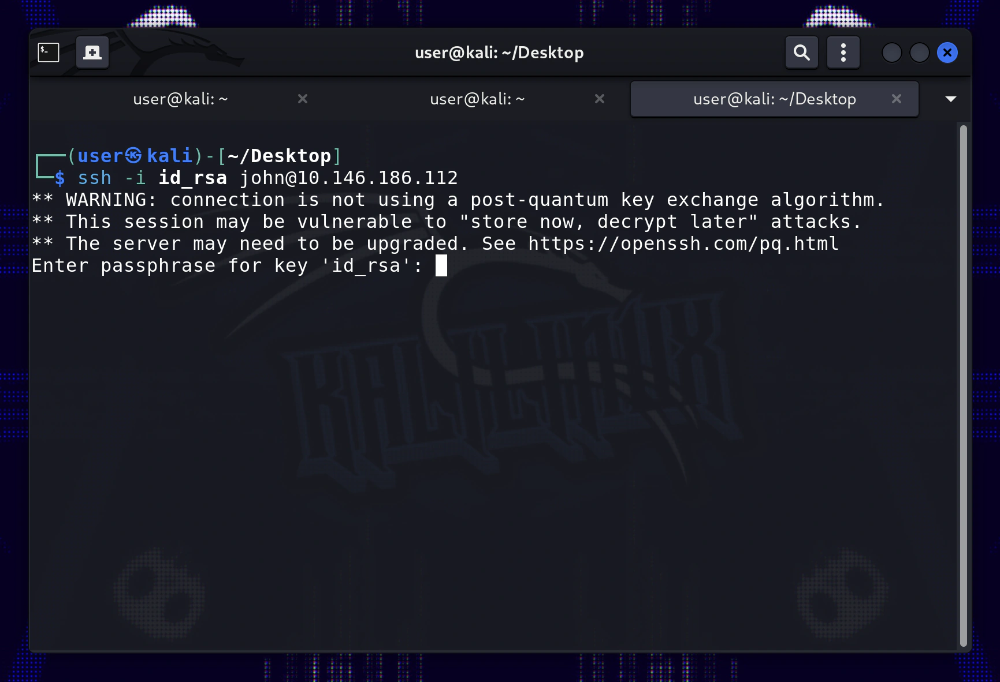

Looking at the output from the login command in the screenshot above, we can see we've made some progress, the private key has been accepted, but it now asks us for a passphrase.

Fortunately there is also a way to brute-force or do a dictionary attack on this passphrase. Ironically, we can use a hash cracking tool called `John` (short for John the Ripper), to convert our private key into a hash, and then to crack that hash.

To do this conversion we can use `ssh2john`, a tool complimentary to `john` (and part of its password cracking suite), which will extract the encrypted passphrase from the key, and convert it into a hash format that `john` can use.

Here is the command for that conversion:

```
ssh2john id_rsa > rsa_hash
```

This command simply uses `ssh2john` on our `id_rsa` key file, and then redirects that (with `>`) into a new file called `rsa_hash`.

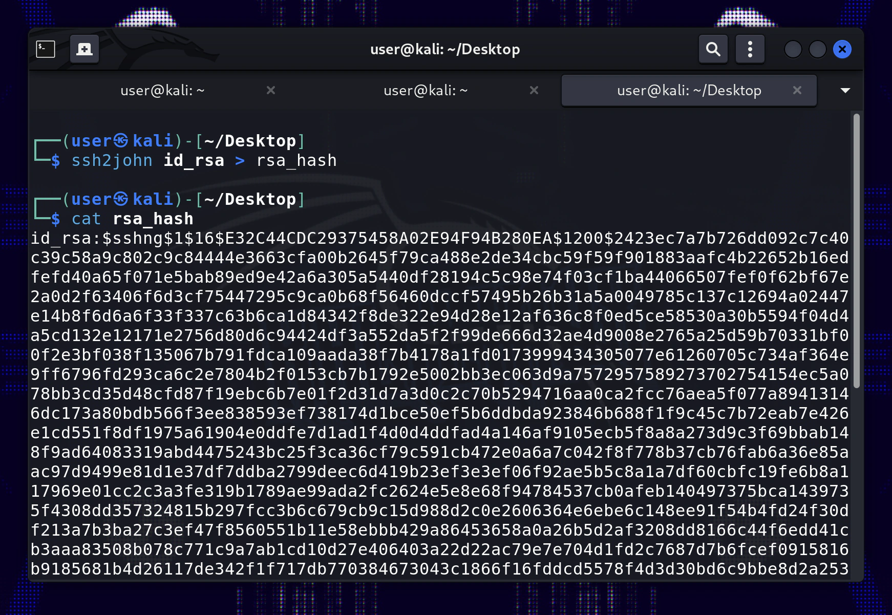

Now that we have a hash of the passphrase from the private key, we can use John the Ripper to do the dictionary attack with the command below.

```
john --wordlist=/usr/share/wordlists/rockyou.txt --format=ssh rsa_hash
```

Breaking down the command:
- `john` uses the main John the Ripper password cracking program
- `--wordlist=/usr/share/wordlists/rockyou.txt`, this part uses the flag `--wordlist=` to denote the path to the word list file used for the dictionary attack. We are using the exact same `rockyou.txt` file we used in the Hydra command.
- `--format=ssh`, this is optional as John the Ripper should auto-detect the correct format, but you can explicitly set it for accuracy.
- `rsa_hash` is the file we just created containing the hash to be cracked.


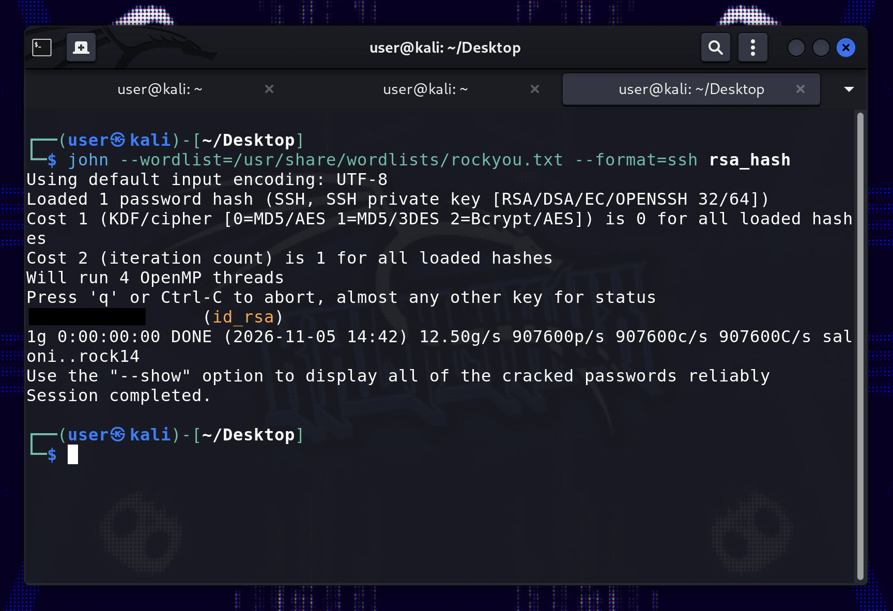

The result from the command can be seen in the screenshot above, and we can see that we have successfully cracked the hash and acquired the passphrase for the private key.

Now we should be able to attain access to John's account via the ssh login, let's try this.

### user.txt

Using the same command as we've used before, we'll use an ssh login command specifying the RSA private key, the username of `john`, and the address of our target machine `10.146.186.112`.

```
ssh -i id_rsa john@10.146.186.112
```

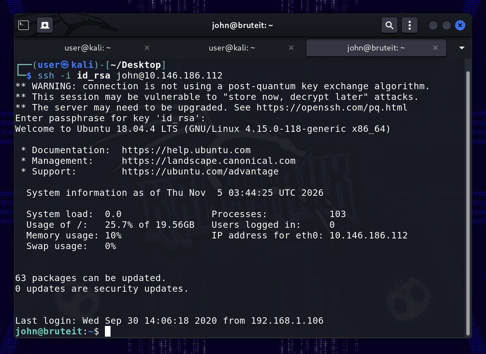

Excellent, as we can see, after providing our newly acquired passphrase from the last step, we now have successfully logged in to John's account on the target machine and gotten a shell!

Now that we are in the account, naturally we'll want to look around. Also, the next question is simply 'user.txt', so we'll want to look for that file and read it.

Using `ls` we can list the files in our current directory.

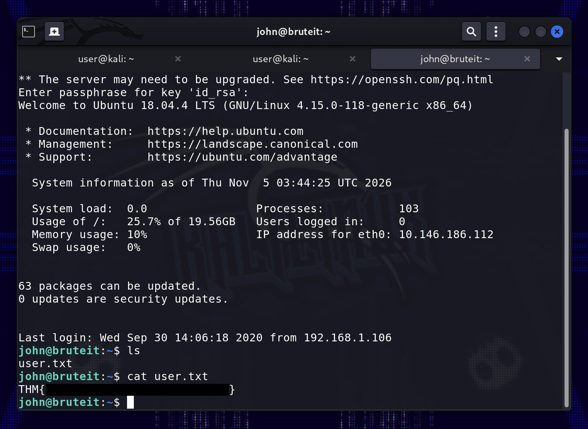

As seen in the image here, conveniently the current directory has the exact file we are after: `user.txt`. We can use `cat user.txt` to output the contents of the file to the shell.

The contents of user.txt is a THM flag, this is the answer to our question.

### Web flag

The answer to this question, the 'web flag', we actually found on the admin panel earlier in the writeup right after we logged in.

You can go back to the end of the section/question: 'What is the user:password of the admin panel?', to find the part where we found this.


## Privilege escalation

The final part of this CTF is the privilege escalation section. We have a shell, and access to John's user account on the target machine via ssh. Now to get root access and get the final flag, we'll need to find a way to get root access.

### What is the root's password?

We need to find a way to get root's password for this question, if we can get that we can log in to root and own the machine. From there we can easily find the flag.

A good way to start searching for ways to elevate privileges is to check if we have any elevated privileges at all already, if we have any we might be able to leverage them to gain more.

We can use `sudo -l` to list any sudo/root privileges we might have on John's account.

```
sudo -l
```

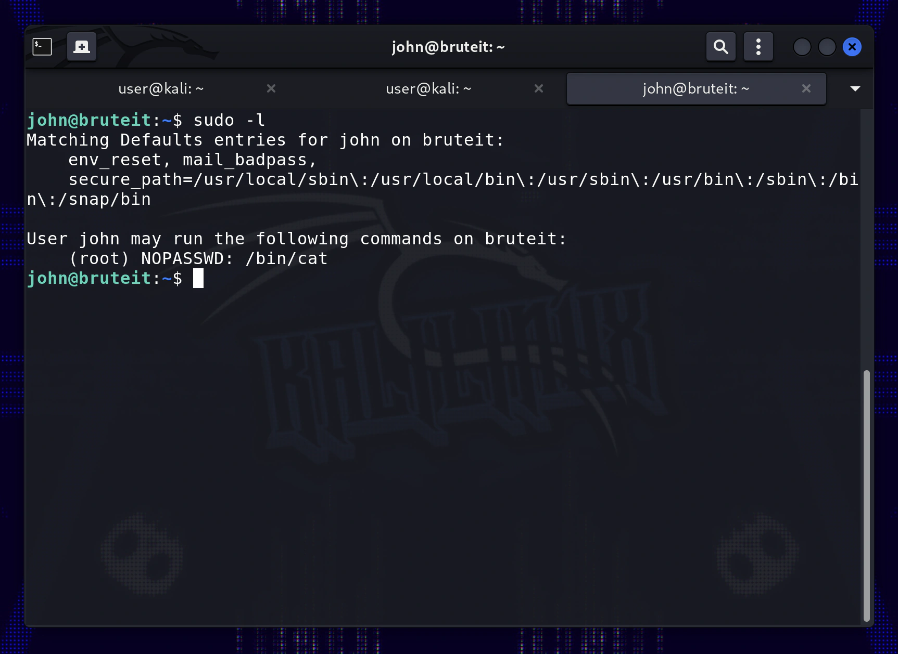

Looking at the output of this command, fortunately we can see we have something. It says John has root permissions to run the `/bin/cat` binary without a password. This is the same `cat` command we use to read (concatenate) files and output them to the shell. This is a vulnerability we can exploit, it means we can use `cat` to read any file on the system that would otherwise need root permissions to interact with. 

One of the highest value targets for us right now is getting root's password. On many Linux distributions (and on the Ubuntu distro we are on), passwords are stored in a file called `shadow` at the path: `/etc/shadow`.

:::note
A common way to start finding ways to escalate privileges on Unix-like systems, is to check [GTFOBins](https://gtfobins.org/), it has a searchable library of built-in functions that can be exploited to elevate privileges.
:::

Let's use out new-found ability, using `cat` as root to read the `/etc/shadow` passwords file with the following command.

```
sudo cat /etc/shadow
```

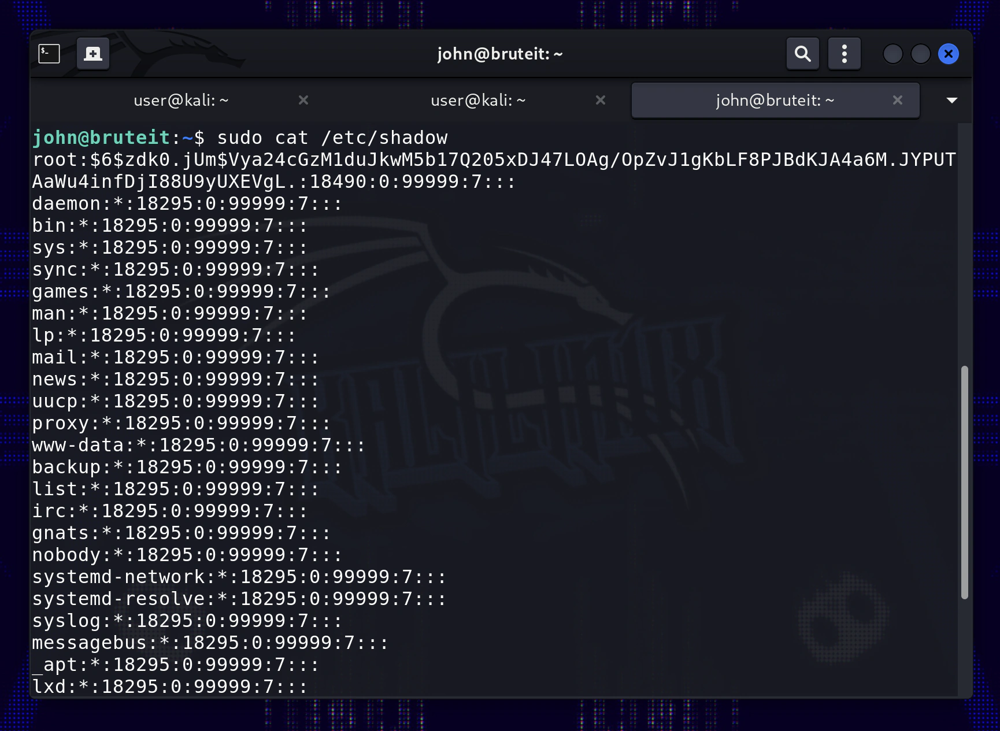

It worked! Great, so now we can see all the passwords for the system found in the shadow file, including root's password. 

However, these passwords are stored in a hash format, so we can't simply use them to log in like normal. Again, we will use John the Ripper just like before to crack the hash and get the password in plaintext form.

In the following command I use `echo` to print root's password hash, and redirect it into a new file called `root_hash` with `>`. Then I used essentially the same `john` command as before on this new `root_hash` file, with the `rockyou.txt` word list.

```
echo 'root:$6$zdk0.jUm$Vya24cGzM1duJkwM5b17Q205xDJ47L0Ag/OpZvJ1gKbLF8PJBdKJA
4а6М.JYPUTAaWu4infDjI889yUXEVgL.:18490:0:99999:7:::' > root_hash

john --wordlist=/usr/share/wordlists/rockyou.txt root_hash
```

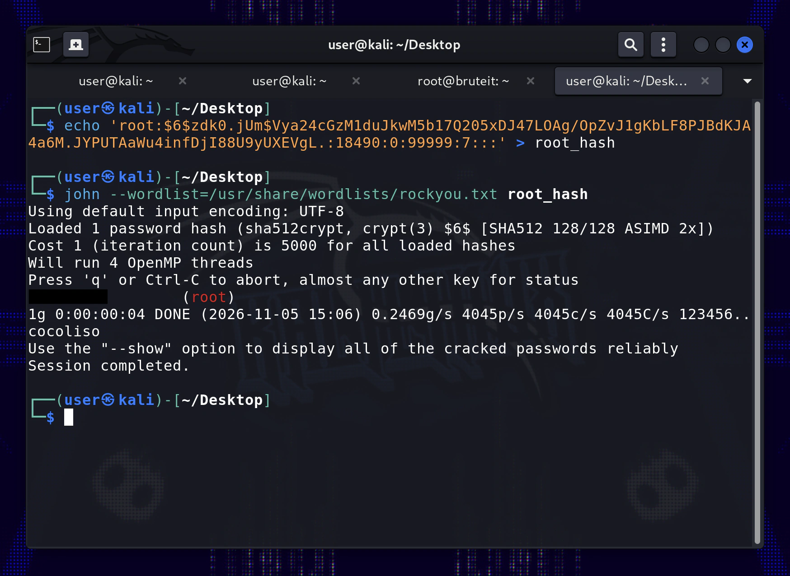

Looking at the results of these two commands, we can see that it worked, we now have root's password.

### root.txt

We are here, the final question. We have root's password, and our task is to read `root.txt`, which presumably contains the final flag.

First we will want to log in as root. We can do this with `su root`, this is to switch users to the username `root`. From there we can enter the password we just found, and we are now logged in as root!

Next, we need to search around for `root.txt`. The most obvious place is in the root folder, so let's change directory with `cd /root/`. Now we can list the contents of the root directory with `ls`. And our suspicions are confirmed to be true, the `root.txt` file is sitting there in the root directory. 

The final command will be `cat root.txt`, and we now have out root flag!

```
su root
cd /root/
ls
cat root.txt
```

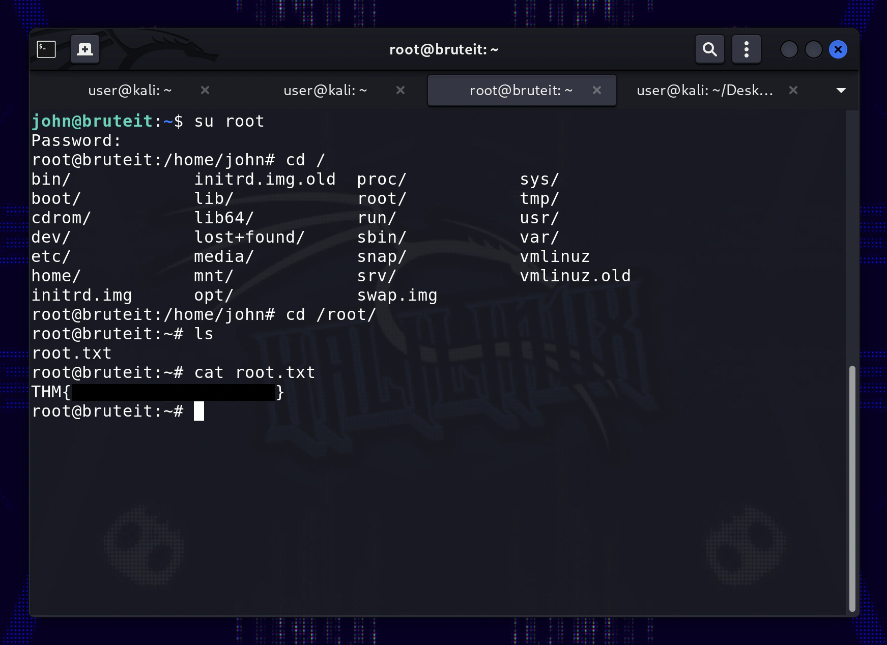


And with that final flag, we have now completed the Brute It CTF. Thanks for reading! I hope you'll join me for the next one.


